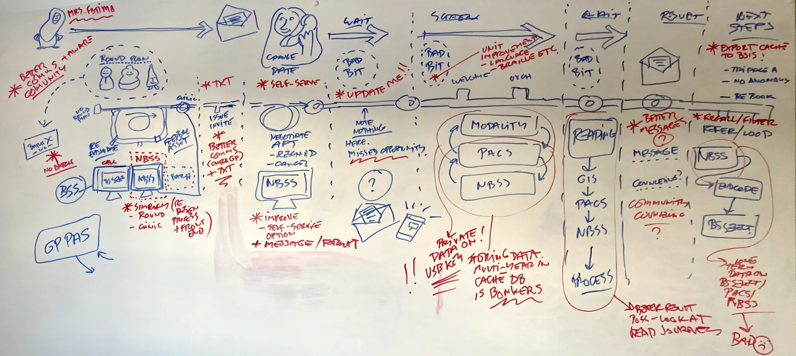
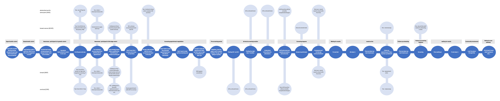
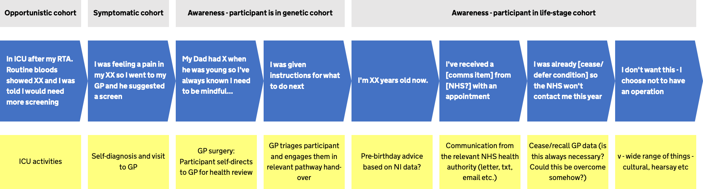
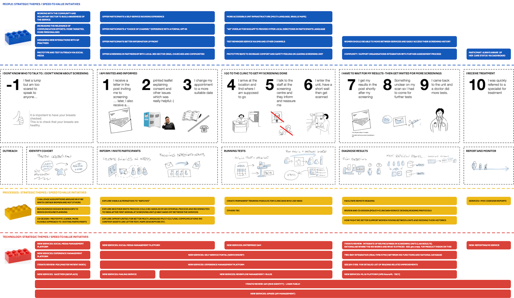
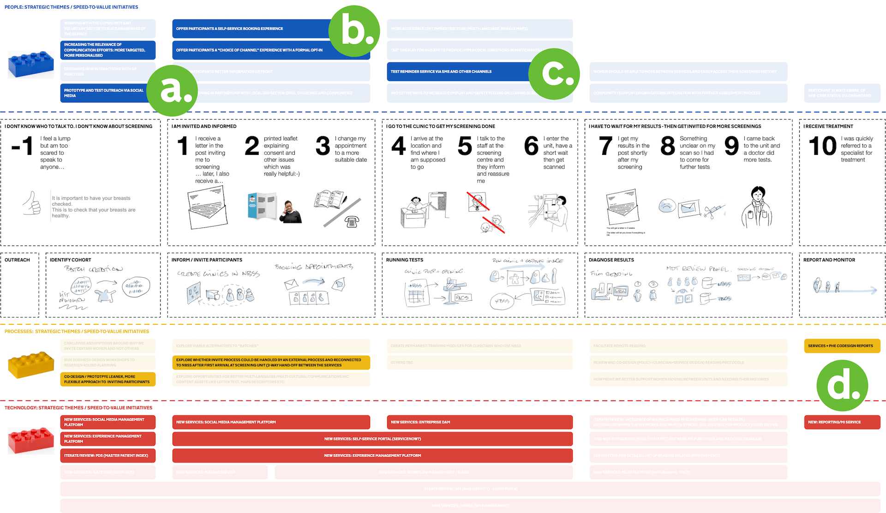

## Situation

The NHS screening services, including those for breast, cervical and bowel cancer, were all supported by one digital organisation, responsible for the digital transformation of those services (twelve separate services in all). The teams involved were working hard in difficult circumstances:
  
- A shared view of patient touchpoints across the twelve screening patient journeys had yet to be built
- Infrastructure procurement added constraints to an already complex situation
- The cohort management and screening data storage systems needed replacing urgently
- The focus had understandably been on digital, leaving less time for multichannel or system interactions
- A complex network of vendors, each with their own priorities, made decisions harder to align

## My challenge

**My role was to uncover and synthesise the user insights enough to allow my customer to make difficult decisions about what to do next.**

  The complexity in the patient journey for screening was not so much in the multiple processes, but in the multiple channels through which the patient's needs were addressed (or underserved). My work identified issues with physical location of machines, language used on hospital signage and multiple other touchpoints. 

## What I did

### Understanding the ecosystem constraints

- Unravel the stakeholder spaghetti (NHS, public health bodies and others)
- Desk research, onboarding with data, review user interviews
- Primary service design research (role-play workshops with SMEs and stakeholders)
- Policy safari, meeting stakeholders across policy, digital and clinical. How the pieces fit together

### Understanding the patient experience

- Learn the multiple patient journeys
- Understand these journeys in the wider context of preventative medicine, considering the impacts of genetics, culture, economics, education etc.

### Understanding the journey across all types of screening (cervical, breast, bowel etc.)

- Build a picture of archetypical patients
- Role play these experiences with all stakeholders and SMEs
- Develop an "extensible" journey that will support a plan to build once and reuse across different screening pathways.

<!-- {:.zoomable-image} -->

  The task was to examine the twelve processes and find overlaps and similarities. The objective was to reuse as much data and technology as possible while minimising disruption to patients and supporting cohort managers in the trusts.

### Mapping out the technology

- Understand the architecture of how patient data is captured, stored, and transferred between devices, buildings, networks and vehicles
- Understand the reasons behind previous technology choices and explore options to think differently about the problem

  Keeping a single version of the truth for patient data has historically been challenging, so cohort management happens across a wide range of touchpoints. Establishing these points of connection against the stages of the patient journey is a foundational activity in planning a transformation.

### Sensemaking and evangelism

- Facilitate a series of design thinking workshops with product and programme leadership to create a collective understanding of the situation and document the challenges to the digital screening service so that leadership could tell the story and win further funding.
- Run ideation with a cross-disciplinary team of leaders. Establish the blueprint of the "extensible service" with an emphasis on identifying the "LEGO pieces" that could be re-used between silos and stakeholders. 
- Facilitate strategy sessions to map out the end-to-end service with all the LEGO pieces and collectively prioritise the elements. 

<figure style="display:flex;">
  
  
</figure>

  Helping leaders visualise where an intervention can happen both in the lifecycle of the end user and in the front-stage to back-stage dimension. LEGO bricks were used to reinforce the idea of modularity and that with the right research, it would be possible to identify the right next steps.

## Results

**Across the multiple screening patient journeys, four strategic themes or areas of focus emerged and I produced a blueprint document showing the elements to focus on in each of the four themes. Product leadership were then able to build my findings and recommendations into the business case for digital investment.** 

The four themes, marked a to d in the blueprint at the top of this page, were:

- Targeted outreach: more relevant, personalised communications, with outreach prototyped and tested via social media
- Self-service booking: letting participants book for themselves and choose their channel
- Reminders: a reminder service via SMS and other channels
- Reporting: co-designed reports and a new reporting and management information service

My stakeholder was successful in their application and the extensible service MVP went into production, with further screening journeys planned to follow.

